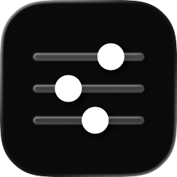
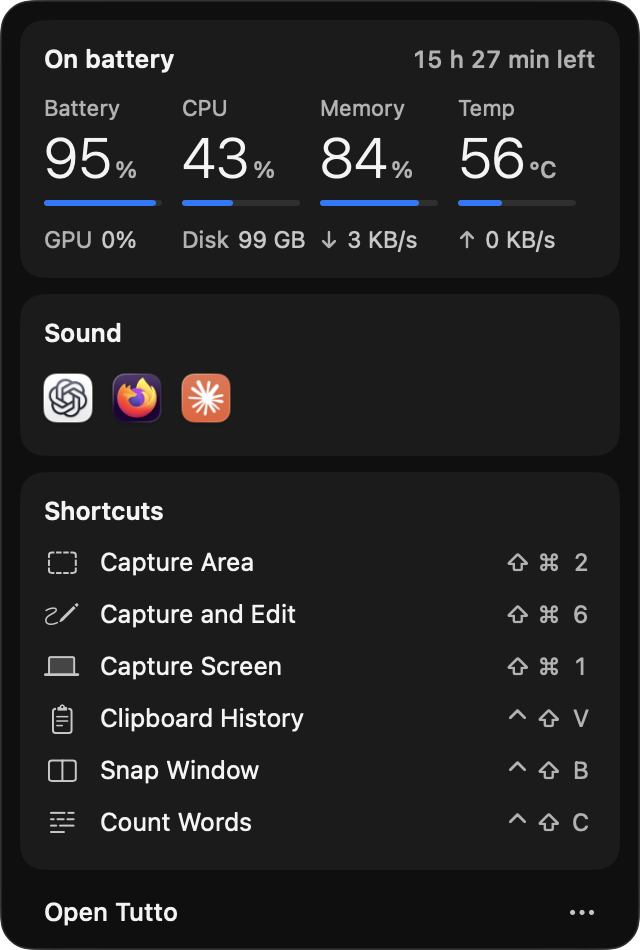

<p align="center"></p>

<h1 align="center">Tutto</h1>

<p align="center"><b>Every Mac utility you actually use, in one quiet menu bar app.</b><br>
Battery &amp; system load · temperatures &amp; fans · clipboard history · window snapping · screenshots with OCR · archives from Finder · trackpad corner right-click.</p>

Tutto is seven everyday tools in one native Swift app that uses **13 MB of memory and no measurable CPU while idle**. Every tool can be switched off, and a tool that's off uses nothing at all.

<p align="center">
  
  &nbsp;&nbsp;
  
</p>

## Install

Requirements: macOS 14 or later (built and tested on macOS 26.5 on an M5 MacBook Pro), Xcode 26 to build.

```bash
cd ~/Documents/XCode/Tutto
scripts/build.sh --install
```

That builds a release `Tutto.app`, signs it with your Apple Development identity, and installs it in `/Applications`. Then open it from Spotlight (`⌘Space`, type "Tutto"). The welcome window walks through:

1. **Tools** — all seven are on; switch off anything you don't want.
2. **Access** — two macOS switches (see [Permissions](#permissions)).
3. **Keys** — the five shortcuts below.
4. **Try it** — press your trackpad's corner and watch the right-click land.

If another app already uses one of the shortcuts below, macOS may deliver the keys to both apps. Change the shortcut in Tutto › Shortcuts or in the other app.

## Use

| Shortcut | What it does |
|---|---|
| `⌘⇧2` | Select an area → copied to the clipboard (no editor to dismiss) |
| `⌘⇧1` | The whole screen under the pointer → clipboard |
| ``⌘⇧` `` | Select an area → screenshot editor |
| `⌃⇧V` | Clipboard history: type to search, double-click or `↩` to paste into the app you were in (your clipboard stays as it was; Clipboard › "Keep pasted items on the clipboard" changes that), `⌘↩` copy, `⇥` filter by type, `⇧⌘P` pin, `⌘⌫` delete |
| `⌃⇧B` | Window palette: type "left half", "max", "next display"…, `↩` |

Every shortcut can be re-recorded in **Tutto › Shortcuts** (click it, press the new keys; Esc cancels, Delete removes). Every window action can also get its own shortcut.

**While selecting an area:** the pointer is a crosshair with its position in pixels just below-right of it (the selection's size while you drag); drag to select, click a window to take just that window, click the desktop for the whole screen, `Shift` for a square, `Space`+drag to move the selection, `Tab` copies the color under the crosshair, `Esc` cancels.

**In the screenshot editor:** with no tool, drag to make a selection box (move it, drag its handles; `↩` crops to it). `P` draw, `H` highlight, `A` arrow, `R` rectangle, `[`/`]` thickness, eight colors plus any color. `T` copies all text (in the selection if there is one) and QR codes. `Tab` copies the hovered pixel's hex color. `⌘S` saves to Downloads (configurable), `⌘C` copies, **`Esc` copies and closes**. `⌘Z` undoes.

**Menu bar panel:** battery (charge, health, cycles, max/design capacity, watts, top energy users), CPU, GPU, memory, disk, temperatures and fan, the Trackpad Corner editor, and one-click capture/clipboard/window buttons. Click any number for the full page in the app.

**Finder:** right-click an archive for **Extract Here**, **Extract to "Name"**, **Extract to…**; right-click anything for **Compress to ZIP**. Archives can also be opened with Tutto by double-clicking (Archives › Make Default).

**Automation:** `tutto://do/capture-area`, `capture-screen`, `capture-edit`, `clipboard`, `windows`, `quit` run an action; `tutto://open/<page>` (e.g. `battery`, `shortcuts`) opens a page — handy from Shortcuts, scripts or a Stream Deck.

**Can't see the menu bar icon?** On MacBooks with a camera notch, a full menu bar hides new icons behind the notch. Tutto notices and tells you; quit a menu bar app you no longer need, or hold ⌘ and drag icons to reorder them. Everything in the panel is also in the app (Spotlight › Tutto).

**Fans:** Sensors & Fans › Fan › Auto / Custom / Max. Fans always return to Auto when you quit Tutto, the Mac sleeps, Sensors is switched off, or Tutto stops unexpectedly.

## Permissions

| Permission | Powers | Asked |
|---|---|---|
| Accessibility | Trackpad Corner, moving windows, pasting from clipboard history | Welcome window / first use |
| Screen Recording | Screenshots, color picking, text recognition | Welcome window / first capture |
| Finder extension | The Extract / Compress right-click items | Archives page (System Settings › General › Login Items & Extensions › Extensions) |
| Fan helper (App Background Activity) | Setting fan speeds — reading never needs it | Only when you first choose Custom or Max |
| Files & folders | Saving to Downloads, extracting in Desktop/Documents/Downloads | macOS asks once per folder |

Tutto has no network code and no analytics. Clipboard history stays in `~/Library/Application Support/Tutto/Clipboard`. Copies that password managers mark as concealed are never recorded.

## How it stays light

- **Nothing runs while you're not looking.** System readings, temperatures and the `top` process feed run only while the panel or a page shows them, and stop the moment it closes.
- **Event-driven where macOS allows.** Shortcuts are Carbon hot keys (the system calls Tutto), Trackpad Corner wakes only when a finger touches the trackpad, battery changes come from IOKit notifications.
- **The one unavoidable timer** — macOS has no clipboard-changed notification — checks a local counter about once a second with wide timer leeway so macOS folds it into wake-ups that happen anyway, slows to every 4 s when you're away, and stops while the screen is locked.
- **Off means off.** A module that's switched off releases its object, timers, taps, hot keys and (for Archives) the Finder extension.

Measurements and comparisons with comparable utilities are in [docs/PERFORMANCE.md](docs/PERFORMANCE.md).

## Limitations (honest)

- **Fan control** writes the SMC through a root helper you approve once (System Settings › General › Login Items & Extensions). Verified on an M5: Max spins the fan to about 6,550 rpm and quitting returns it to Auto.
- **Temperatures:** Apple doesn't document which sensor is the CPU or GPU on Apple silicon. Tutto labels CPU/GPU only from published SMC key tables (on M5, confirmed to respond to CPU and GPU load on this Mac) and shows the rest as SoC die, battery and SSD.
- **Archives:** Tutto uses the libarchive built into macOS, so encrypted RAR and 7z archives and zstd/lz4 compression can't be opened (password-protected zip works). Compression produces zip.
- **Screen Recording:** macOS may periodically ask you to re-confirm it; that's macOS policy.
- **Shortcut clashes:** if another app registers the same keys, macOS may deliver them to both apps. Change one of the shortcuts.
- **Not included:** remote, clock and Bluetooth monitoring, alerts, scrolling capture, pinned screenshots, blur, cloud upload, an app launcher.

## Development

```bash
swift test                               # 194 unit tests (corner engine, readers, archives, clipboard, layout…)
scripts/build.sh --debug                 # debug build with offscreen UI snapshots:
build/Products.noindex/Tutto.app/Contents/MacOS/Tutto --snapshot /tmp/shots panel battery editor
scripts/measure.sh 180 Tutto <OtherApp> …           # idle CPU / memory / wake-ups, side by side
scripts/measure-modules.sh 90            # idle cost per module combination
```

Layout: `Sources/TuttoKit` (testable logic: Trackpad Corner engine, system readers, sensors/fans, archives, clipboard store, window layout, shortcuts), `Sources/Tutto` (app and UI), `Sources/TuttoFinder` (Finder extension), `Sources/TuttoHelper` (root fan helper), `Sources/CBridges` (C shims for MultitouchSupport, SMC, IOHID and libarchive). Requirements and their status: [docs/REQUIREMENTS.md](docs/REQUIREMENTS.md). Test results: [docs/TEST_RESULTS.md](docs/TEST_RESULTS.md).

## License

MIT. libarchive (BSD) ships with macOS.
