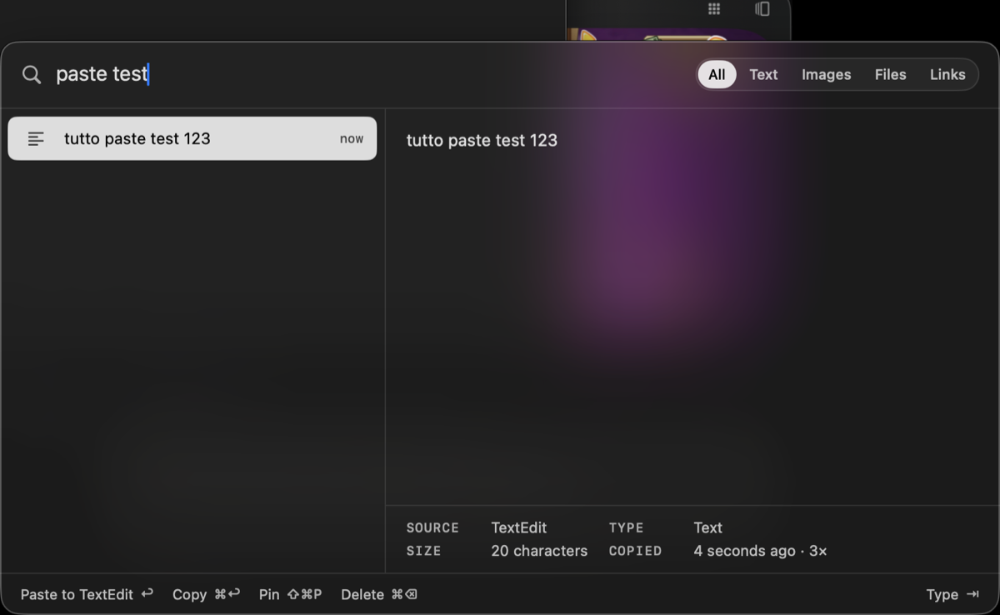

<p align="center"></p>

<h1 align="center">Tutto</h1>

<p align="center"><b>Every Mac utility you actually use, in one quiet menu bar app.</b><br>
Battery &amp; system load · temperatures &amp; fans · clipboard history · window snapping · screenshots with OCR · archives from Finder · trackpad corner right-click · word counter.</p>

Tutto is eleven everyday tools in one native Swift app that uses **13 MB of memory and no measurable CPU while idle**. Every tool can be switched off, and a tool that's off uses nothing at all.

<p align="center">
  
  &nbsp;&nbsp;
  
</p>

## Install

Requirements: macOS 14 or later (built and tested on macOS 26.5 on an M5 MacBook Pro), Xcode 26 to build.

```bash
cd ~/Documents/XCode/Tutto
scripts/build.sh --install
```

That builds a release `Tutto.app`, signs it with your Apple Development identity, and installs it in `/Applications`. Then open it from Spotlight (`⌘Space`, type "Tutto"). The welcome window walks through:

1. **Tools** — all are on except the scrolling strip, which rearranges every window and waits until you want it; switch off anything you don't want.
2. **Access** — two macOS switches (see [Permissions](#permissions)).
3. **Keys** — the six shortcuts below.
4. **Try it** — press your trackpad's corner and watch the right-click land.

If another app already uses one of the shortcuts below, macOS may deliver the keys to both apps. Change the shortcut in Tutto › Shortcuts or in the other app.

## Use

| Shortcut | What it does |
|---|---|
| `⌘Tab` | Window switcher: every window gets its own card, not just every app (three Firefox windows are three cards, on any Space or in full screen, with a picture of each). Hold `⌘`, press `Tab` to move, let go to switch; a quick tap goes back to the previous window. While it's open: `1`–`9` switch to that card, `W` close, `M` minimize, `Q` quit, `H` hide, `F` fill the screen, `C` centre, `N` next display, `R` rename the window, `/` search, `` ` `` only that app's windows, `Esc` cancel |
| ``⌘` `` | The front app's windows only (all your Firefox windows) |
| `⌘⇧2` | Select an area → copied to the clipboard (no editor to dismiss) |
| `⌘⇧1` | The whole screen under the pointer → clipboard |
| `⌘⇧6` | Select an area → screenshot editor |
| `⌃⇧V` | Clipboard history: type to search, double-click or `↩` to paste into the app you were in (your clipboard stays as it was; Clipboard › "Keep pasted items on the clipboard" changes that), `⌘↩` copy, `⇥` filter by type, `⇧⌘P` pin, `⌘⌫` delete |
| `⌃⇧B` | Window palette: type "left half", "max", "next display"…, `↩` |
| `⌃⇧C` | Word counter: the cursor is ready, press `⌘V` (or type) to see words, characters (with and without spaces), sentences, paragraphs, reading and speaking time, and the same for a selection. `⌘K` clears, `Esc` closes |

Every shortcut can be re-recorded in **Tutto › Shortcuts** (click it, press the new keys; Esc cancels, Delete removes). Every window action can also get its own shortcut.

**While selecting an area:** the pointer is a crosshair with its position in pixels just below-right of it (the selection's size while you drag); drag to select, click a window to take just that window, click the desktop for the whole screen, `Shift` for a square, `Space`+drag to move the selection, `Tab` copies the color under the crosshair, `Esc` cancels.

**In the screenshot editor:** with no tool, drag to make a selection box (move it, drag its handles; `↩` crops to it). `P` draw, `H` highlight, `A` arrow, `R` rectangle, `[`/`]` thickness, eight colors plus any color. `T` copies all text (in the selection if there is one) and QR codes. `Tab` copies the hovered pixel's hex color. `⌘S` saves to Downloads (configurable), `⌘C` copies, **`Esc` copies and closes**. `⌘Z` undoes.

**Menu bar panel:** only what you open the menu bar for. Its first line says how the Mac is doing (a problem if there is one, else the battery: "On battery · 4 h 9 min left"). Battery, CPU, memory and temperature are large numbers with GPU, free disk space and network speed beneath, and any of them opens its page in the app. A Sound strip shows your apps: click one to mute it at the speakers. The tools' shortcuts are rows you can click instead of pressing the keys (Capture Area, Capture and Edit, Capture Screen, Clipboard History, Snap Window, Count Words); the keys light up as if pressed and the tool opens. Settings, battery health, the fan modes and Trackpad Corner's controls live in the app; ⋯ holds pause clipboard history, pause Trackpad Corner, open at login, the Shortcuts and Permissions pages, and quit.

**Sound:** click an app in the panel's Sound row (or flip its switch on the Sound page) to mute it at your speakers and headphones — Discord's pings go quiet while Firefox keeps playing. The app itself keeps playing, so screen recordings and tools listening to it still hear it. Its helper processes are muted with it, it stays muted when it restarts, and "Mute or unmute the front app" can get a shortcut.

**Scrolling strip** (off until you turn it on, on its page under Tools › Scrolling Strip): every window sits side by side on one strip, full height between the menu bar and the Dock, and the screen scrolls along it — nothing overlaps and opening a window never shrinks the others. Windows are arranged when you use a strip key (or ⌘Tab to one that's out of view); otherwise they stay wherever you or the window palette put them ("Arrange windows › All the time" makes the strip hold its shape constantly). Hold `⌃⌥` to see the strip bar, with a picture of each window. All your apps in full screen? "Bring Them Here" puts them on the strip, full width. `⌃⌥←` `⌃⌥→` move between windows, `⌃⌥⇧←` `⌃⌥⇧→` move a window along, `⌃⌥1`–`9` jump (9 is the last), `⌃⌥R` cycles the width (25 → 33 → 50 → 66 → 75 %), `⌃⌥F` full width, `⌃⌥C` centre, `⌃⌥]` / `⌃⌥[` stack into the left / right column, `⌃⌥⇧]` pop out, `⌃⌥⇧T` tabbed column, `⌃⌥P` pin to the left edge, `⌃⌥T` float, `⌃⌥N` next display, `⌃⌥Q` stop (every window goes back on screen). Every key can be changed in Shortcuts. ⌃⌥ + scroll moves along the strip, a three- or four-finger swipe can too, and a frosted bar of app icons shows where you are. Dialogs, Quick Look and fixed-size windows float; native full screen is left alone.

**Finder:** right-click an archive for **Extract Here**, **Extract to "Name"**, **Extract to…**; right-click anything for **Compress to ZIP**. Archives can also be opened with Tutto by double-clicking (Archives › Make Default).

**Automation:** `tutto://do/capture-area`, `capture-screen`, `capture-edit`, `clipboard`, `windows`, `word-counter`, `mute-front-app`, `quit` run an action; `tutto://open/<page>` (e.g. `battery`, `shortcuts`) opens a page — handy from Shortcuts, scripts or a Stream Deck.

**Can't see the menu bar icon?** On MacBooks with a camera notch, a full menu bar hides new icons behind the notch. Tutto notices and tells you; quit a menu bar app you no longer need, or hold ⌘ and drag icons to reorder them. Everything in the panel is also in the app (Spotlight › Tutto).

**Fans:** Sensors & Fans › Fan › Auto / Custom / Max. Fans always return to Auto when you quit Tutto, the Mac sleeps, Sensors is switched off, or Tutto stops unexpectedly.

## Permissions

| Permission | Powers | Asked |
|---|---|---|
| Accessibility | Trackpad Corner, the window switcher, the scrolling strip, moving windows, pasting from clipboard history | Welcome window / first use |
| Screen Recording | Screenshots, color picking, text recognition, window titles and pictures in the switcher | Welcome window / first capture |
| System Audio Recording | Muting apps in Sound (Tutto holds their sound back; nothing is recorded) | The first time you mute an app |
| Finder extension | The Extract / Compress right-click items | Archives page (System Settings › General › Login Items & Extensions › Extensions) |
| Fan helper (App Background Activity) | Setting fan speeds — reading never needs it | Only when you first choose Custom or Max |
| Files & folders | Saving to Downloads, extracting in Desktop/Documents/Downloads | macOS asks once per folder |

Tutto has no network code and no analytics. Clipboard history stays in `~/Library/Application Support/Tutto/Clipboard`. Copies that password managers mark as concealed are never recorded.

## How it stays light

- **Nothing runs while you're not looking.** System readings, temperatures and the `top` process feed run only while the panel or a page shows them, and stop the moment it closes.
- **Event-driven where macOS allows.** Shortcuts are Carbon hot keys (the system calls Tutto), Trackpad Corner wakes only when a finger touches the trackpad, battery changes come from IOKit notifications.
- **The one unavoidable timer** — macOS has no clipboard-changed notification — checks a local counter about once a second with wide timer leeway so macOS folds it into wake-ups that happen anyway, slows to every 4 s when you're away, and stops while the screen is locked.
- **The window switcher waits, it doesn't watch.** A key filter on its own thread lets every key through except the trigger; the window list is built when you press ⌘Tab (about 10 ms) and window pictures are taken only while it's open, then dropped 30 s later.
- **The scrolling strip moves only when something changes.** Each app reports its window changes through an Accessibility observer, a display link runs only while windows slide, and windows move on one queue per app so a slow app never holds up the rest.
- **Off means off.** A module that's switched off releases its object, timers, taps, hot keys and (for Archives) the Finder extension.

Measurements and comparisons with comparable utilities are in [docs/PERFORMANCE.md](docs/PERFORMANCE.md).

## Limitations (honest)

- **Fan control** writes the SMC through a root helper you approve once (System Settings › General › Login Items & Extensions). Verified on an M5: Max spins the fan to about 6,550 rpm and quitting returns it to Auto.
- **Temperatures:** Apple doesn't document which sensor is the CPU or GPU on Apple silicon. Tutto labels CPU/GPU only from published SMC key tables (on M5, confirmed to respond to CPU and GPU load on this Mac) and shows the rest as SoC die, battery and SSD.
- **Archives:** Tutto uses the libarchive built into macOS, so encrypted RAR and 7z archives and zstd/lz4 compression can't be opened (password-protected zip works). Compression produces zip.
- **Screen Recording:** macOS may periodically ask you to re-confirm it; that's macOS policy.
- **Window switcher:** while you type in a password field macOS hides keystrokes from every app, so ⌘Tab shows macOS's own switcher there. If Tutto quits or crashes, macOS's ⌘Tab is back immediately (nothing in the system is switched off). It relies on private window-server calls to list windows on other Spaces and switch to them; a window on another Space that nothing has touched since its app started is reached through that app's Window menu. Video that apps protect from capture shows as a dark picture.
- **Scrolling strip:** macOS doesn't let an app hide another app's window, so a window out of view waits in a bottom corner of its display with a sliver showing. Strip keys are caught before other apps' shortcuts (so they win while the strip is on), except in password fields, where macOS hides keystrokes; there the regular shortcut answers if no other app took the keys first. A three-finger swipe can clash with macOS's own swipe between full-screen apps: Mac Setup on the strip's page points out the setting.
- **Shortcut clashes:** if another app registers the same keys, macOS may deliver them to both apps. Change one of the shortcuts.
- **Not included:** remote, clock and Bluetooth monitoring, alerts, scrolling capture, pinned screenshots, blur, cloud upload, an app launcher.

## Development

```bash
swift test                               # 194 unit tests (corner engine, readers, archives, clipboard, layout…)
scripts/build.sh --debug                 # debug build with offscreen UI snapshots:
build/Products.noindex/Tutto.app/Contents/MacOS/Tutto --snapshot /tmp/shots panel battery editor
scripts/measure.sh 180 Tutto <OtherApp> …           # idle CPU / memory / wake-ups, side by side
scripts/measure-modules.sh 90            # idle cost per module combination
```

Layout: `Sources/TuttoKit` (testable logic: Trackpad Corner engine, system readers, sensors/fans, archives, clipboard store, window layout, shortcuts), `Sources/Tutto` (app and UI), `Sources/TuttoFinder` (Finder extension), `Sources/TuttoHelper` (root fan helper), `Sources/CBridges` (C shims for MultitouchSupport, SMC, IOHID and libarchive). Requirements and their status: [docs/REQUIREMENTS.md](docs/REQUIREMENTS.md). Test results: [docs/TEST_RESULTS.md](docs/TEST_RESULTS.md).

## License

MIT. libarchive (BSD) ships with macOS. Labels are set in [Geist](https://github.com/vercel/geist-font) 1.8.1 (SIL Open Font License 1.1, bundled with its license in `Resources/Fonts`).
